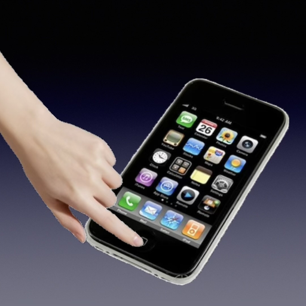

# Halcyon

**Forward thinking, legacy reborn.**

*Formerly Light Touch for iOS (QIOS)*

# Roadmap to 1.0

Where this port stands, what 1.0 needs, and what is deliberately left for later. Written at update 83.

What changed in each update is in [CHANGELOG.md](CHANGELOG.md). Why each emulator patch exists is in
[ios/README.md](ios/README.md) — that file is the real technical record and worth reading before changing anything
under `ios/patches/qemu-ios`.

## What 1.0 means

Not "everything works." It means the port feels finished: the first ten minutes are clean, the things it claims to
do it does everywhere, and when something breaks you can tell why.

- [ ] **Installs are reliable on iOS 3 through 6.** Working as of update 75 (the 55-style rebuild: skip installd on
      iOS 6, unlink the install cache and icon caches, restart installd and SpringBoard, poll for the rebuild).
      Needs to stay working — it has regressed before.
- [ ] **Installing does not wedge the system.** Every install restarts SpringBoard, which force-closes every running
      app. Update 82 (patch 0032) gives back the GL memory those apps leave behind. Confirm before closing this.
- [ ] **Boot is tolerable and the first screen explains itself.**
- [ ] **iPad does not come up sideways.** Open.
- [ ] **The test set genuinely works**, not just "draws something": Where's My Water, Need for Speed, Super Monkey
      Ball, Crash Team Racing, Wipeout 1 and 2, Minecraft PE.
- [ ] **The iOS 6 look, tilt, simulated GPS and the icon are consistent** in every screen that offers them. A
      setting that exists in one place and not another reads as unfinished even when it works.
- [ ] **Reports are small enough to send and say what went wrong.** The log splits at 32 MB as of update 81.

## Open, with what is already known

**Wipeout 1 and 2 — black shapes.** Obstacles drew solid black. `glProgramUniform*EXT` (EXT_separate_shader_objects,
slots 892-910) were being dropped; GLKit's effects set their uniforms through them, so colour and lighting stayed at
zero. Patch 0032 forwards them. Unconfirmed on device.

**Minecraft PE — crash on launch.** Launched when GL memory was already full, so this may simply be the memory bug.
Retest after 0032 before looking further. Patch 0031 (a framebuffer whose colour is the drawable's renderbuffer stays
the drawable) was aimed at its earlier black-after-rotation bug.

**FIFA 14 — crashes before it creates a GL context.** Not a graphics bug. Update 80 added install-time diagnostics
(binary slices, MinimumOSVersion, UIRequiredDeviceCapabilities) that have not been read yet. Deferred: likely a
rabbit hole.

**Goat Simulator Z — free play mode does not start.** Needs a log.

**iPad orientation.** Installs and boots; orientation is wrong throughout.

**Monopoly — matrix palette.** Uses `glCurrentPaletteMatrixOES`, `glMatrixIndexPointerOES`,
`glWeightPointerOES` (slots 807-810), which are unimplemented. Skinned/animated pieces will be wrong. Looked fine in
testing, so low priority.

## Experimental, and why

**Keep Textures Compressed** (update 86, off by default). PVRTC artwork handed to the host GL as it is rather than
decoded to RGBA at 8x the memory. It trades this decoder's exact output for the host driver's, so it can change how
a game looks; every refusal falls back to decoding, and the setting turns it off per device. Worth testing broadly
before it could ever be a default.

## Deliberately not in 1.0

Each of these is a new subsystem, not a fix, and would end the release on a cliffhanger:

- Real camera support
- Real (non-simulated) GPS
- Jailbreaking an already-set-up device
- A Cydia repo hub
- Anti-aliasing
- JIT-less speed work
- Fake serial numbers for iServices — declined, not deferred

## For whoever picks this up

The build is GitHub Actions, not a local toolchain: push and it builds. `ios/qemu-ios.json` pins the QEMU commit the
patches apply to; the patches in `ios/patches/qemu-ios` are applied with `git apply` in CI, in numeric order, and all
of them must apply cleanly.

Two rules that were learned the hard way and are worth keeping:

1. **Verify before shipping.** Every patch compiles against all four GL host builds (ANGLE, EAGL, the EAGL source
   variant, ES3) before it goes out. A wasted build costs an hour of someone's day.
2. **A dropped call must never be silent.** `[gles] UNHANDLED <name>` exists because Super Monkey Ball rendered as
   noise for days over one entry point that was being discarded without a word. An app that renders wrong looks
   exactly like an app that renders right until something says which call went nowhere.

On authorship: the emulator itself is not AI-written — see the note in [README.md](README.md). The port under
`ios/`, including every patch in `ios/patches/qemu-ios`, was written with AI and tested by hand on a real device.

The emulator side is C and is the hard part. The app side is Swift (`ios/App/Sources`) and is where most of what a
user actually touches lives — it is the approachable end if you are learning.
